# Design

Hermes' creation-before/after evidence and retention policy inform the design;
the Codex adapter and storage engine are independently implemented.

```mermaid
flowchart LR
  A[PreToolUse: literal absence + bounded root snapshots] --> B[SQLite pending record]
  B --> C[PostToolUse: same session and call]
  C --> D[Regular file + protected-path check + fingerprint]
  D --> E[Tracked file]
  E --> F[Quick preview: retention + session/turn + fingerprint]
  G[Explicit cache/log roots] --> H[Manual deep preview]
  H --> I[Single-use 15 minute plan]
  F --> I
  I --> J[Pending guard + current policy + SHA-256 revalidation]
  J --> K[Durable move intent]
  K --> L[Same-root quarantine]
  L --> M[Restore without overwrite]
  L --> N[Explicit per-item permanent purge]
```

Each session gets a SHA-256-derived scratch directory. IDs are not interpreted
as path components. Literal arguments can name paths within that directory.
The adapter handles direct `path`, `file_path`, `filename`, shell literal tokens,
quoted literal paths, and `apply_patch` Add/Update headers. It ignores output and
does not evaluate source code, variables or command substitution. In 0.1.4,
matching tool calls also compare bounded existence snapshots inside managed
roots. Only paths absent before and present after enter fingerprint validation.
Existing device/inode identities prevent renamed or relocated old files from
being adopted. An explicit project enrollment binds a dedicated descendant directory to one
session, device/inode and retention policy; existing files are never adopted.
All snapshots share a 2000-entry per-phase budget. Errors and cross-turn/legacy
pending ambiguity disable dynamic coverage instead of broadening it.

Project enrollments are optional schema-1 configuration. Pending JSON supports
both old literal lists and new snapshot evidence, so no SQL migration is needed.
Project policy is included in plans and revalidated for moves; root identity is
also checked for restore/purge. Withdrawal keeps files and tracking records while
revoking plan authorization. Default preview and all existing protections remain.

SQLite uses WAL, FULL synchronous writes and `BEGIN IMMEDIATE` for state changes.
Pending records key on `(session_id, tool_use_id)`. The database records schema
version 1 and refuses unknown schema versions. Plans live in state, not editable
external plan files. Each candidate includes its current authorization policy,
device, inode, size, mode, mtime, ctime and SHA-256.

Manual previews include busy candidates so the preview command's own native
PreToolUse lease cannot hide a selected session. `blocked` names the candidates
currently guarded by a pending tool; `bytes` includes those candidates. This is
a snapshot, not an execution exemption: move() always checks live pending tools
again. Automatic quarantine plans exclude busy candidates and report a skipped
reason. Preview-mode lifecycle plans may display them. All session, turn,
retention, protected-path and fingerprint filters still apply. Without an
explicit session, manual previews continue to omit active sessions.

Status exposes `pending_sessions` with live tool counts and oldest timestamps;
the existing `pending` count includes all rows, including expired leases awaiting
normal Hook housekeeping. Status never edits those rows. Schema 1 is unchanged.

A move intent is committed before rename. Final state is committed after identity
verification. Recovery inspects source and destination instead of assuming the
last database operation succeeded. Restore uses exclusive hardlink creation plus
unlink on POSIX, and non-overwriting rename on Windows. A POSIX restore crash
between link/unlink retains both names and reports `needs-review`. Purge intent
is similarly journaled. No recursive deletion or broad empty-directory sweep.

Automatic hooks only operate on tracked scratch. Manual deep maintenance is a
separate enrollment and plan path. Quarantine stays on the source filesystem,
so a rename cannot silently become an unbounded cross-volume copy.

The implementation is a trusted-user maintenance tool. It deliberately does not
claim a hostile-process filesystem sandbox. See SECURITY.md for races and leases.
