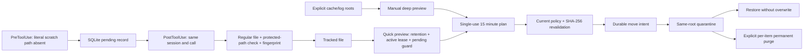

# Design

Hermes' creation-before/after evidence and retention policy inform the design;
the Codex adapter and storage engine are independently implemented.

Each session gets a SHA-256-derived scratch directory. IDs are not interpreted
as path components. Tool arguments must name literal paths within that directory.
The adapter handles direct `path`, `file_path`, `filename`, shell literal tokens,
quoted literal paths, and `apply_patch` Add/Update headers. It ignores output and
does not evaluate source code, variables or command substitution.

SQLite uses WAL, FULL synchronous writes and `BEGIN IMMEDIATE` for state changes.
Pending records key on `(session_id, tool_use_id)`. The database records schema
version 1 and refuses unknown schema versions. Plans live in state, not editable
external plan files. Each candidate includes its current authorization policy,
device, inode, size, mode, mtime, ctime and SHA-256.

A move intent is committed before rename. Final state is committed after identity
verification. Recovery inspects source and destination instead of assuming the
last database operation succeeded. Restore uses exclusive hardlink creation plus
unlink on POSIX, and non-overwriting rename on Windows. A POSIX restore crash
between link/unlink retains both names and reports `needs-review`. Purge intent
is similarly journaled. No recursive deletion or broad empty-directory sweep.

Automatic hooks only operate on tracked scratch. Manual deep maintenance is a
separate enrollment and plan path. Quarantine stays on the source filesystem,
so a rename cannot silently become an unbounded cross-volume copy.

The implementation is a trusted-user maintenance tool. It deliberately does not
claim a hostile-process filesystem sandbox. See SECURITY.md for races and leases.
